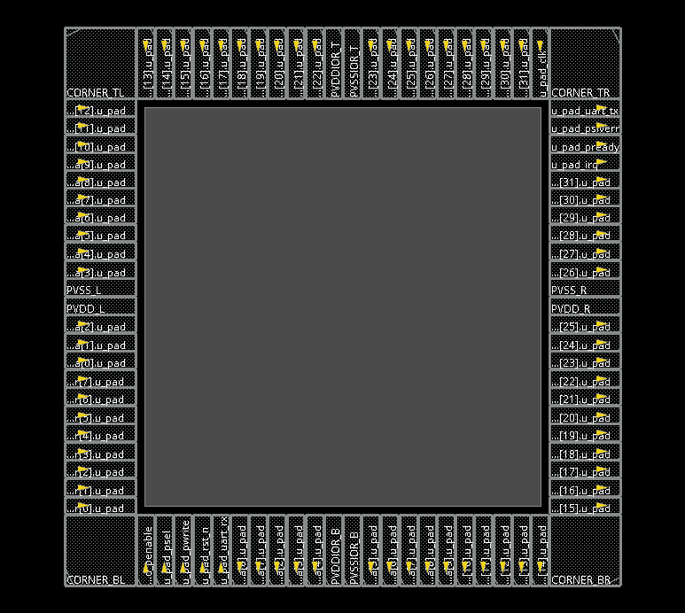

# UART V3 chip-level P&R : Init + IO 배치

- 대상 : `uart_chip_top_allpad` (UART V3 APB3 Peripheral + 모든 외부 포트 PAD)
- 범위 : P&R 0단계 `0_InitDesign.tcl` (Init → Floorplan → IO 배치 → IO filler)
- 실행일 : 2026-11-06
- Tool : Cadence Innovus 22.1 (legacy mode)

## 1. 설계 조건

| 항목 | 값 |
|---|---|
| Netlist | Genus 합성 netlist (10 ns constraint) |
| Clock | 100 MHz (10 ns), MMMC: SS / FF corner |
| Die | 1892 × 1900 µm |
| Core-to-IO | 30 µm (core power ring 공간) |
| Signal PAD | 60 × 240 µm |
| Corner PAD | 240 × 240 µm |

## 2. 실행

```tcl
innovus -log init_only
source 0_InitOnly.tcl        ;# 0_InitDesign.tcl과 동일, 저장 이름만 InitOnly
checkPlace init_only.checkPlace.rpt
```

`0_InitDesign.tcl` 순서

1. `init_design` : tech LEF, std cell LEF, IO LEF, netlist, MMMC
2. `checkDesign` : netlist / library / power / floorplan 점검
3. `floorPlan -site CoreSite -d 1892 1900 30 30 30 30`
4. `loadIoFile uart_padall.io` : PAD 배치 (**반드시 floorPlan 다음**, 6장 참고)
5. `globalNetConnect` : core VDD/VSS, IO ring VDDIOR/VSSIOR
6. `source respace.tcl` : 좌우 PAD 간격을 정수 µm로 재배치 (1 µm IO filler로 모든 틈을 채우기 위해)
7. `addIoFiller` : PAD 사이를 IO filler로 채워 IO ring 전원선 연결
8. `timeDesign -prePlace`, `saveDesign`

## 3. IO 구성

| 위치 | 전원 PAD | Signal PAD |
|---|---|---|
| Left | VDD, VSS (core) | input 21 |
| Top | VDDIOR, VSSIOR (IO ring) | input 20 |
| Bottom | VDDIOR, VSSIOR (IO ring) | input 5 + output 15 |
| Right | VDD, VSS (core) | output 21 |
| Corner | 4 | |
| **합계** | **8** | **82 (input 46 + output 36)** |

IO 파일 instance 94개 = signal 82 + power 8 + corner 4.
power PAD 8개와 corner 4개는 netlist에 없는 physical cell이라 IO 파일에서 `cell=`로 생성 (12개).

## 4. 확인 결과

| 항목 | 결과 | 판정 |
|---|---|---|
| checkPlace | No violations found | PASS |
| IO 파일 instance | 94 (cell 지정 12) | 설계와 일치 |
| PAD 좌표 | power 8 + corner 4 모두 이전 정상 실행과 동일 | PASS |
| checkDesign 경고 `no FanOut pin` | 91 | 의도된 미사용 net (아래) |
| Session ERROR | IMPOAX 7, IMPSYT-6245 1 | 결과 무관 (서버 OpenAccess 환경, saveDesign) |

`no FanOut pin` 91개의 원인

| net | 원인 |
|---|---|
| `w_txFifoCount`, `w_rxFifoCount`, `r_count` 일부 비트 | 읽는 곳이 없는 FIFO count 비트 |
| `r_prdata[31:16]` 등 | 상수 0 출력을 Genus가 top PAD 쪽으로 올리고 원래 net은 남김 |
| `UNCONNECTED_HIER_Z*` | 위 상수 출력 때문에 생긴 빈 계층 연결 |

같은 상수 출력은 LEC에서도 확인됨 (상수 출력 17개를 inout으로 변환한 F28 메시지). 기능에는 영향 없음.

## 5. 캡처



- 네 corner, power PAD 8개(좌우 VDD/VSS, 상하 VDDIOR/VSSIOR)
- 가운데 회색 영역이 core (standard cell 배치 전)

## 6. 이슈 : IO 파일을 floorPlan 전에 읽어 power PAD가 겹침

| | 정상 (`loadIoFile`을 floorPlan 뒤) | 문제 (`init_io_file`로 init 때) |
|---|---|---|
| PVDD_L | x = 0, y = 924.0 µm | x = **270**, y = 921.3 µm |
| PVSS_L | x = 0, y = 986.0 µm | x = **270**, y = 980.5 µm |
| 간격 | 62 µm (PAD 높이 60 µm보다 넓음) | **59.2 µm → 겹침** |

- 원인 : 스크립트를 교재 형식으로 정리하면서 IO 파일을 `init_design` 단계(`init_io_file`)에서 읽도록 바꿈. 이후 `floorPlan -d`가 die 크기를 다시 정하면서, IO 파일로 만든 power PAD 2개가 die 가장자리가 아닌 core 경계(x = 270 µm)로 밀림. `respace.tcl`은 x > 300 µm인 PAD를 왼쪽 PAD로 보지 않아 이 둘을 재배치하지 않음.
- 증상 : **timing과 DRC는 모두 깨끗했고, checkPlace에서만** `IO instance overlap 2`로 드러남.
- 해결 : floorPlan 다음에 `loadIoFile`로 원복. 재실행 후 checkPlace 0, PAD 좌표가 이전 정상 실행과 동일.
- 교훈 : 완료 기준을 "DRC 0, timing 위반 0"에서 **checkPlace 0**까지로 넓힘. Init 단계에서도 checkPlace를 바로 실행.

## 7. 이후 단계 (같은 netlist, 2026-11-06 재실행)

| 단계 | 결과 |
|---|---|
| P&R 0~5 | setup WNS 3.255 ns, hold WNS 12 ps, 위반 0, checkPlace 0, DRC 0 |
| LEC 합성 ↔ P&R | PASS, Equivalent 386, unmapped 0, black box 0 |
| Post-layout GLS | SS/FF × 100/48 MHz, 33 PASS × 4, SDF 미적용(SDFINF) 0 |
